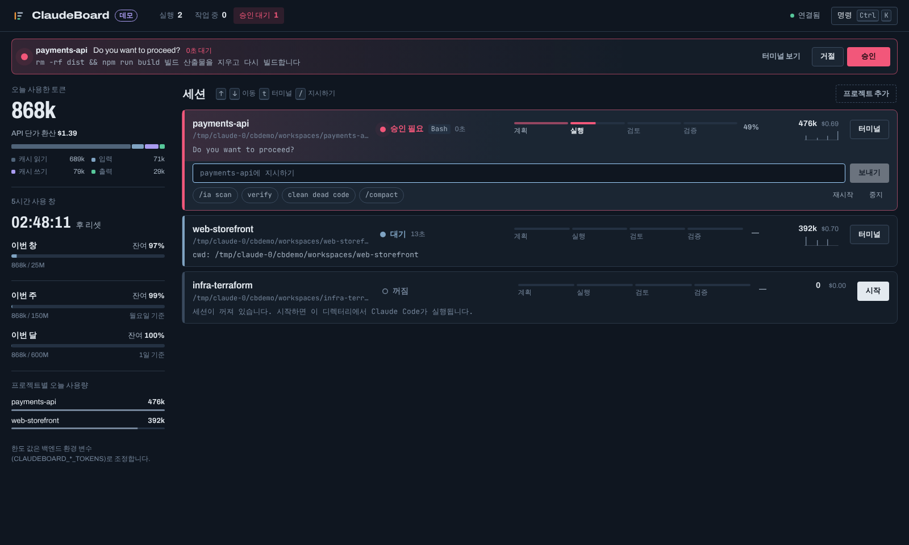

# ClaudeBoard — Claude Multi-Project Commander

로컬에서 돌아가는 여러 Claude Code 세션을 브라우저 한 화면에서 모니터링하고, 지시하고, 승인하는 관제 대시보드입니다.



## 기획 의도

Claude Code로 여러 프로젝트를 동시에 진행하면 VS Code 창이나 터미널 탭을 계속 오가야 합니다. 그러다 보면 이런 비용이 생깁니다.

- **멈춘 세션을 늦게 발견합니다.** 위험 명령 앞에서 `[y/n]` 승인을 기다리는 세션이 다른 창 뒤에 숨어 있으면 몇십 분씩 그대로 멈춰 있습니다.
- **전체 그림이 보이지 않습니다.** 어느 세션이 추론 중이고 어느 세션이 빌드 중이며 어디까지 진행됐는지 알려면 창을 하나씩 열어 봐야 합니다.
- **토큰 소비를 실시간으로 알 수 없습니다.** 한 세션이 루프에 빠져 토큰을 태우고 있어도, 사용량 한도에 걸리고 나서야 알게 됩니다.

ClaudeBoard는 이 세 가지를 한 화면에서 해결하는 "관제탑"입니다. 세션마다 항공 관제의 비행 진행 스트립처럼 한 줄을 할당해 상태·진행률·토큰을 나란히 보여주고, 사람이 개입해야 하는 순간(승인, 완료, 토큰 급증)만 강하게 알립니다.

## 주요 기능

| 영역 | 기능 |
| --- | --- |
| 세션 관리 | 등록한 디렉터리마다 Claude Code를 백그라운드 PTY로 띄우고 유지합니다. 시작·중지·재시작을 지원하며, 브라우저를 닫아도 세션은 계속 돕니다. |
| 지시 | 스트립의 입력창이나 퀵 액션(`/ia scan`, `verify`, `clean dead code`, `/compact`)으로 프롬프트를 보냅니다. ⌘K에서 `@프로젝트 지시문`으로 보낼 수도 있습니다. |
| 일괄 지시 | 세션 목록 헤더의 **일괄 지시**를 켜면 세션마다 체크박스가 생깁니다. 체크한 세션 중 실행 중인 것에만 같은 지시(직접 입력 또는 퀵 액션)를 동시에 보내고, 꺼진 세션은 건너뛴 뒤 결과를 토스트로 알립니다. |
| 터미널 | xterm.js로 실시간 출력을 보고 키보드로 직접 조작합니다. 다시 접속하면 최근 512KB가 재생됩니다. |
| 상태 추적 | `IDLE`(대기) / `THINKING`(추론) / `EXECUTING`(파일 수정·Bash, 주황 바) / `REQUIRES_APPROVAL`(승인 대기) 4단계를 판정해 색과 펄스로 표시합니다. |
| 모델 배지 | 세션 카드에 사용 중인 모델을 `Opus 5.5`처럼 짧게 보여줍니다. 터미널 하단 HUD의 `Model:` 항목을 우선하고, 없으면 사용량 로그의 가장 최근 응답 모델을 씁니다. 꺼진 세션에서는 숨깁니다. |
| 진행률 | `plan → execute → review → verify` 단계 표식과 Todo 체크리스트로 0~100%를 계산합니다. 단계·Todo 신호가 없는 작업(일반 질문 등)은 퍼센트를 지어내지 않고 경과 시간과 흐르는 바로 표시합니다. |
| 토큰 센터 | 오늘 토큰과 API 단가 환산 비용, 5시간 사용 창 리셋 카운트다운, 주간·월간 잔여량, 프로젝트별 순위와 30분 스파크라인을 보여주고 토큰 급증(Token Hog)을 경고합니다. |
| 승인 | 승인 요청이 감지되면 상단 배너에 [승인]/[거절]이 뜹니다. 클릭 한 번으로 해당 PTY에 응답 키가 전달됩니다. |
| 폴더 열기 | 세션을 선택하면 나오는 **폴더 열기**로 프로젝트 폴더를 VS Code·Cursor·Finder·터미널 중 하나로 엽니다. 열기 전에 앱을 확인받고, 마지막으로 고른 앱을 기본값으로 기억합니다. macOS 전용입니다. |
| 알림 | 승인 요청, 작업 완료, 토큰 급증을 화면 토스트와 브라우저 데스크톱 알림(창이 가려져 있을 때)으로 알립니다. |

## 빠른 시작

요구 사항: Node.js 20.19 이상, pnpm 10, 실제 사용 시 PATH에 있는 `claude` CLI. node-pty는 네이티브 모듈이라 macOS에는 Xcode Command Line Tools가 필요합니다.

```bash
pnpm install

# 데모 모드: claude 없이 모의 CLI로 전체 흐름을 확인합니다 → http://127.0.0.1:4317
pnpm build
pnpm --filter @claudeboard/backend start:demo

# 개발 모드: 백엔드(4317) + Nuxt 개발 서버(3000) → http://localhost:3000
# 백엔드는 watch 없이 뜹니다. 소스 변경 시 자동 재기동이 필요하면 백엔드에서 `pnpm dev:watch`
# (재기동하면 자식 claude 세션이 종료되므로, 대시보드 안의 Claude가 이 저장소를 고치는 중에는 쓰지 않습니다)
pnpm dev

# 운영 모드: 빌드된 프론트엔드를 백엔드가 같은 포트에서 서빙합니다 → http://127.0.0.1:4317
pnpm build && pnpm start
```

화면에서 **프로젝트 추가**를 눌러 디렉터리 경로를 직접 입력하거나 **찾아보기**로 폴더를 열어 가며 고르면 그 디렉터리에서 `claude`가 실행됩니다. 목록은 `~/.claudeboard/projects.json`에 저장되며, 항목에 `"autoStart": true`가 있으면 서버가 시작될 때 함께 실행됩니다.

### 키보드 단축키

| 키 | 동작 |
| --- | --- |
| `⌘K` / `Ctrl+K` | 명령창 (세션 시작·중지, 터미널 열기, 승인, `@이름 지시문`) |
| `↑` `↓` | 세션 스트립 이동 |
| `t` | 선택한 세션의 터미널 열기 |
| `/` | 선택한 세션의 지시 입력창으로 이동 |
| `Esc` | 터미널 패널·대화상자 닫기 (터미널 안의 Esc는 Claude Code로 전달되어 작업을 중단합니다) |

## 구조

```
claudeboard/
├── packages/shared/          WebSocket 프로토콜과 도메인 타입 (백엔드·프론트 공용 단일 진실 공급원)
│   └── src/index.ts
├── apps/backend/             로컬 서버 (Fastify + ws + node-pty)
│   ├── src/
│   │   ├── index.ts          진입점: 설정을 읽고 서버를 엽니다
│   │   ├── server.ts         REST, WebSocket 업그레이드, Origin 검사, 브로드캐스트, 정적 파일 서빙
│   │   ├── sessionManager.ts 프로젝트당 PTY 세션: 스폰, 링버퍼, 가상 화면, 상태 전이, 알림
│   │   ├── statusParser.ts   화면 텍스트 → 상태·승인 요청·워크플로우 진행률 (순수 함수)
│   │   ├── usageTracker.ts   ~/.claude 세션 로그 증분 집계, 5시간 창, 토큰 급증 감지
│   │   ├── officialUsage.ts  Claude 계정의 5시간·주간 사용률과 리셋 시각 조회 (로그 합산보다 우선하는 출처)
│   │   ├── pricing.ts        모델별 단가표와 비용 계산
│   │   ├── projectStore.ts   ~/.claudeboard/projects.json 저장소
│   │   ├── openApp.ts        프로젝트 폴더를 허용 목록의 앱으로 열기 (open -a, 셸 없이 인자 배열로 실행)
│   │   ├── dirBrowser.ts     프로젝트 추가용 폴더 탐색 (하위 디렉터리 이름만 반환)
│   │   └── config.ts         환경 변수
│   ├── mock/mock-claude.mjs  데모·테스트용 Claude Code 흉내 CLI
│   └── test/                 단위 테스트 + 데모 세션 E2E
├── apps/frontend/            Nuxt 4 SPA (Vue 3 Composition API, TypeScript, Scoped SCSS)
│   └── app/
│       ├── app.vue           화면 골격과 전역 단축키
│       ├── composables/      useCommander(WebSocket·전역 상태), useNotify(토스트·데스크톱 알림), useNow
│       ├── components/       SessionRack/SessionStrip, WorkflowTrack, UsageRail, ApprovalBanner,
│       │                     TerminalPanel/XtermView, CommandPalette, BaseDialog 등
│       ├── assets/styles/    디자인 토큰과 전역 스타일
│       └── utils/format.ts   숫자·시간·상태 라벨 포맷
└── docs/
    ├── PLAN.md               설계 문서 (인터페이스, 판정 규칙, 디자인 결정)
    └── screenshots/
```

## 동작 원리

### 전체 흐름

```
 브라우저 (Nuxt SPA)                      백엔드 (127.0.0.1:4317)                      로컬
┌──────────────────┐   WebSocket /ws   ┌───────────────────────────────┐   node-pty   ┌──────────────┐
│ 스트립·터미널·배너 │ ◀──────────────▶ │ SessionManager                │ ◀──────────▶ │ claude (cwd A)│
│ useCommander      │   REST /api/*     │  ├ 링버퍼(재생)               │              │ claude (cwd B)│
└──────────────────┘ ◀──────────────▶ │  ├ @xterm/headless 가상 화면  │              └──────────────┘
                                       │  └ statusParser → 상태/진행률 │
                                       │ UsageTracker ◀── ~/.claude/projects/**/*.jsonl (3초마다 증분 읽기)
                                       └───────────────────────────────┘
```

1. 세션을 시작하면 백엔드가 `node-pty`로 프로젝트 디렉터리에서 `claude`를 실행합니다.
2. PTY 출력은 세 곳으로 갑니다. 구독 중인 브라우저(터미널 표시), 링버퍼(재접속 시 재생), 서버 안의 가상 터미널(@xterm/headless)입니다.
3. 출력이 몰리면 120ms 단위로 묶어 가상 화면을 읽고 상태를 판정합니다. 상태가 바뀔 때만 모든 브라우저에 `session` 메시지를 보냅니다.
4. 브라우저의 프롬프트·키 입력·승인 버튼은 WebSocket을 거쳐 해당 PTY의 stdin으로 들어갑니다.

### 상태 판정

Claude Code는 같은 줄을 커서 이동으로 계속 다시 그리는 TUI라서 원시 출력 스트림을 정규식으로 읽으면 깨집니다. 그래서 서버 안에 보이지 않는 터미널을 하나 두고, 사람이 보는 것과 같은 "현재 화면"을 재구성한 뒤 판정합니다. 아래 규칙은 위에서부터 먼저 맞는 것이 적용됩니다.

1. 화면 하단에 `Do you want to …?`와 `1. Yes` 메뉴가 같이 보이면 **REQUIRES_APPROVAL**입니다. 승인은 Enter, 거절은 Esc를 보냅니다.
2. 마지막 줄이 `[y/n]`, `(y/N)`, `(yes/no)`로 끝나면 **REQUIRES_APPROVAL**입니다. 승인은 `y⏎`, 거절은 `n⏎`를 보냅니다.
3. `esc to interrupt`나 스피너 줄이 있으면 작업 중입니다. 가장 가까운 도구 호출이 Bash·Edit·Write처럼 무언가를 바꾸는 도구면 **EXECUTING**, Read·Grep 같은 읽기 도구이거나 도구 호출이 없으면 **THINKING**입니다.
4. 그 밖에는 **IDLE**입니다. 단, 작업 중에서 IDLE로 바뀐 상태가 900ms 이상 유지돼야 확정합니다. 단계 사이에 스피너가 잠깐 사라지는 순간을 완료로 오인하지 않기 위해서입니다.

4초 이상 작업하다가 IDLE이 되면 "작업 완료" 알림을 보냅니다.

### 워크플로우 진행률

출력에 나타난 단계 표식(`[Plan]`, `## Execute`, `Phase: review`, `단계: 검증` 등, 한글 별칭 포함) 중 가장 마지막 것을 현재 단계로 봅니다. 각 단계의 시작값(계획 10%, 실행 35%, 검토 65%, 검증 85%)과 다음 단계 시작값 사이는 Claude Code Todo 목록의 완료 비율(☒/☐)로 채웁니다. 검증 단계에서 IDLE이 되면 100%입니다. `Progress: 72%`처럼 명시한 값이 있으면 그 값을 우선합니다. 단계 표식도 Todo도 없으면 가짜 퍼센트 대신 작업 시작 시각(`busySince`)부터의 경과 시간을 표시하고, 4구간 전체에 줄무늬가 흐르는 불확정 바로 보여줍니다.

### 토큰과 한도

Claude Code는 대화마다 `~/.claude/projects/<인코딩된 경로>/<세션>.jsonl`에 응답별 `usage`를 기록합니다. 백엔드는 이 파일들을 바이트 오프셋 기준으로 새로 추가된 줄만 읽습니다. 같은 응답이 여러 줄에 걸쳐 기록되는 경우를 막기 위해 `message.id`와 `requestId`로 중복을 제거합니다. 각 줄의 `cwd`로 어느 프로젝트의 사용량인지 판별합니다.

- **비용**: 모델별 API 공시 단가로 환산합니다(캐시 쓰기는 입력 단가의 1.25배, 캐시 읽기는 공시값 또는 0.1배). 구독 요금이 아니라 "API였다면 얼마였을지"를 나타내는 추정치입니다.
- **공식 사용률**: 5시간·주간 한도의 플랜, 사용률, 리셋 시각은 `officialUsage.ts`가 Claude 계정에서 직접 읽습니다. Claude Code가 저장한 OAuth 자격 증명(macOS 키체인 또는 `~/.claude/.credentials.json`)의 액세스 토큰으로 사용량 엔드포인트를 조회하며, 토큰 갱신은 하지 않습니다. 아래의 로그 합산 값은 이 조회가 실패할 때의 대체 표시입니다. 조회가 429를 돌려주면 5분(`Retry-After`가 더 길면 그 값) 동안 다시 요청하지 않습니다.
- **5시간 사용 창(로그 합산)**: 첫 요청 시각을 정시로 내림해 창을 열고, 5시간이 지나거나 5시간 넘게 쉬면 새 창을 엽니다. 남은 시간을 카운트다운으로 보여줍니다.
- **주간·월간(로그 합산)**: 월요일 0시, 매월 1일 0시부터 합산합니다. 기준값은 환경 변수로 정합니다.
- **토큰 급증**: 최근 5분 사용량이 임계값을 넘고 다른 활성 프로젝트들의 중앙값보다 3배 이상 많으면 경고합니다. 같은 프로젝트에 대해서는 10분에 한 번만 울립니다.

### 통신 프로토콜

전체 타입은 `packages/shared/src/index.ts`에 있습니다.

| 방향 | 메시지 (`t` 필드) |
| --- | --- |
| 브라우저 → 서버 | `subscribe`, `unsubscribe`, `input`(원시 키), `prompt`(텍스트+엔터), `resize`, `approve`, `start`, `stop`, `restart`, `ping` |
| 서버 → 브라우저 | `hello`(접속 시 전체 상태), `projects`, `session`, `session-removed`, `replay`, `output`(구독자에게만), `usage`, `alert`, `error`, `pong` |

REST: `GET /api/health`, `GET/POST /api/projects`, `POST /api/projects/:id/open`(`{ app }`, 등록된 프로젝트 경로를 허용 목록의 앱으로 열기), `DELETE /api/projects/:id`, `GET /api/fs?path=`(하위 폴더 목록, 숨김 폴더 제외), `GET /api/sessions`, `GET /api/usage`, `GET /api/alerts`

## 환경 변수 (백엔드)

| 변수 | 기본값 | 설명 |
| --- | --- | --- |
| `CLAUDEBOARD_PORT`, `CLAUDEBOARD_HOST` | `4317`, `127.0.0.1` | 로컬 전용으로 바인딩합니다 |
| `CLAUDEBOARD_CMD`, `CLAUDEBOARD_ARGS` | `claude`, 없음 | 세션마다 실행할 명령 (프로젝트별로 덮어쓸 수 있습니다) |
| `CLAUDEBOARD_HOME` | `~/.claudeboard` | 프로젝트 목록 저장 위치 |
| `CLAUDE_CONFIG_DIR` | `~/.claude` | 사용량 로그 위치 |
| `CLAUDEBOARD_TOKEN` | 없음 | 설정하면 `?token=` 또는 `Authorization: Bearer`가 필요합니다 |
| `CLAUDEBOARD_WEEKLY_TOKENS` | 150,000,000 | 주간 할당량 기준값 |
| `CLAUDEBOARD_MONTHLY_TOKENS` | 600,000,000 | 월간 할당량 기준값 |
| `CLAUDEBOARD_WINDOW_TOKENS`, `CLAUDEBOARD_WINDOW_HOURS` | 25,000,000, 5 | 사용 창 한도와 길이 |
| `CLAUDEBOARD_HOG_TOKENS_5M` | 400,000 | 토큰 급증 경고 임계값 (최근 5분) |
| `CLAUDEBOARD_REPLAY_BYTES` | 524,288 | 재접속 시 재생할 출력 크기 |
| `CLAUDEBOARD_DEMO=1` | 꺼짐 | mock-claude로 데모 실행 (임시 디렉터리 사용, 실제 `~/.claude`를 건드리지 않습니다) |

## 디자인

- **콘셉트**: 흔한 카드 그리드 대신 항공 관제탑의 비행 진행 스트립을 빌려왔습니다. 세션 하나가 가로 한 줄이고, 왼쪽 레일 색이 상태를 말합니다. 선택하면 지시 입력과 퀵 액션이 스프링 애니메이션으로 펼쳐집니다.
- **색**: 청회색 바탕 위에 상태 신호색만 씁니다. 대기 `#7fa3c2`, 추론 `#a99bf0`, 실행 `#f0973a`(주황), 승인 `#f2577a`, 완료 `#57c79a`. 색에는 항상 텍스트 라벨이 함께 붙습니다.
- **글꼴**: UI는 Archivo(가변 폭 축으로 숫자와 제목의 폭 조절), 터미널·경로·명령은 JetBrains Mono.
- **모션**: 상태마다 펄스가 다릅니다(추론은 느린 호흡, 실행은 퍼지는 링, 승인은 빠른 링). 모달·배너·탭 표시줄은 스프링, 버튼은 누를 때 살짝 줄어듭니다. `prefers-reduced-motion` 설정 시 모두 꺼집니다.
- **접근성**: 시맨틱 랜드마크, 진행률 `role=progressbar`, 할당량 `role=meter`, 승인 배너 `role=alert`, 명령창 combobox 패턴과 포커스 트랩, 본문 건너뛰기 링크, 키보드 포커스 링.

자세한 결정 근거는 [docs/PLAN.md](docs/PLAN.md)에 있습니다.

## 보안

로컬 도구지만 셸 프로세스를 띄우는 서버입니다. 그래서 `127.0.0.1`에만 바인딩하고, WebSocket과 REST 모두 `localhost` 계열 Origin만 받습니다. 다른 웹사이트가 사용자의 브라우저를 통해 이 서버에 접속하는 공격(CSWSH)을 막기 위해서입니다. 다른 기기에서 접근해야 한다면 `CLAUDEBOARD_TOKEN`을 설정하고 SSH 터널을 쓰세요.

## 개발

```bash
pnpm typecheck   # shared · backend(tsc) · frontend(nuxt typecheck)
pnpm test        # 상태 파서·사용량 단위 테스트 + 데모 세션 E2E
pnpm build       # 백엔드 esbuild 번들(dist/) + nuxt generate(.output/public)
```

E2E 테스트(`apps/backend/test/integration.test.ts`)는 데모 서버를 띄운 뒤 다음을 실제로 확인합니다. WebSocket 접속, 프롬프트 전송, THINKING → EXECUTING → REQUIRES_APPROVAL 전이, 승인, IDLE과 진행률 100%, 사용량 집계, 리사이즈, 외부 Origin 거부. GitHub Actions(`.github/workflows/ci.yml`)가 PR마다 같은 세 명령을 실행합니다.

### 상태 판정 규칙을 고칠 때

Claude Code 화면 문구가 바뀌어 상태가 잘못 나오면 `apps/backend/src/statusParser.ts`의 패턴을 고치고, 실제 화면 텍스트를 `test/statusParser.test.ts`에 픽스처로 추가하세요. 판정 함수는 순수 함수라 화면 줄 배열만으로 테스트할 수 있습니다.

## 알려진 한계

- 상태 판정은 Claude Code의 화면 문구에 의존합니다. CLI 업데이트로 문구가 바뀌면 패턴을 갱신해야 합니다.
- 비용은 API 단가로 환산한 추정치라 실제 청구액과 다를 수 있습니다. 한도는 공식 사용률 조회에 성공하면 계정 값을, 실패하면 로그 합산 추정치를 보여 줍니다.
- PTY 크기는 세션당 하나라서, 여러 브라우저가 같은 터미널을 크기가 다르게 열면 마지막에 리사이즈한 쪽 크기를 따릅니다.
